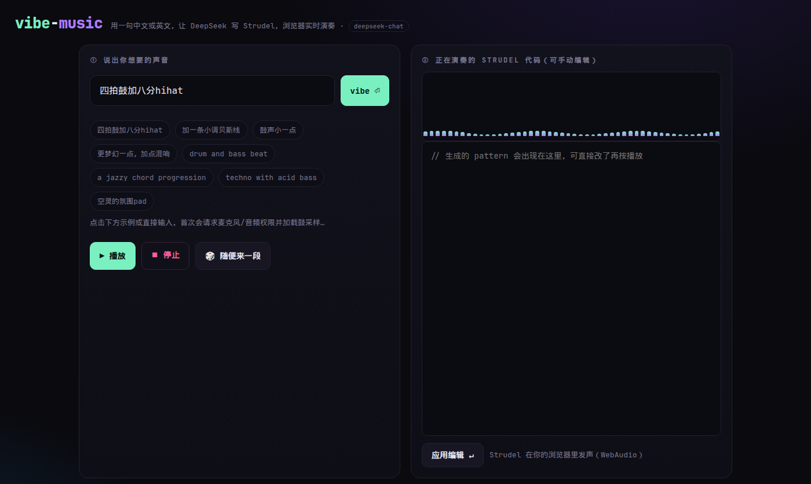

# JamFlow

[](https://jamflow-gray.vercel.app)
[](#notes)

**JamFlow** (formerly vibe-music / vibe-web). **Type a sentence. Hear it.** Chinese or English in, [Strudel](https://strudel.cc) out, played in your browser. [DeepSeek](https://www.deepseek.com/) writes the pattern.

> 打字就能做音乐 — 一句话 → DeepSeek 写 Strudel 代码 → 浏览器实时出声。

**[Open the live demo](https://jamflow-gray.vercel.app)** — nothing to install. Try `四拍鼓加八分hihat` or `a dreamy minor bassline`.



## Quick start

### Use the demo

[https://jamflow-gray.vercel.app](https://jamflow-gray.vercel.app)

### Run the web app yourself

The model key stays on the server. **Never commit it.**

```bash
export DEEPSEEK_API_KEY=...          # required
# optional: DEEPSEEK_BASE_URL         # default https://api.deepseek.com
# optional: DEEPSEEK_MODEL            # default deepseek-chat
cd vibe-web && vercel dev             # international: Vercel
# or a zero-dependency Node server (static files + /api/vibe):
PORT=8080 node server.mjs             # mainland China: see vibe-web/DEPLOY-CN.md
```

On Vercel, set `DEEPSEEK_API_KEY` for the project (Production and Preview). `DEEPSEEK_BASE_URL` and `DEEPSEEK_MODEL` are optional.

### Terminal (strudel-cli)

```bash
cd strudel-cli && npm install
node bin/strudel.mjs start            # tmux live session (needs ffplay + tmux)
node bin/strudel.mjs append 's("bd*4, hh*8")'
```

### Video (Remotion)

```bash
cd video && npm install
npx remotion studio                   # preview
npx remotion render ViralCNVertical out/vibe-rednote.mp4
```

Compositions: `ViralVertical`, `ViralLandscape`, `ViralCNVertical` (小红书竖版). Source clips and audio live in `video/public/`.

## Surfaces

| Folder | What it is |
|--------|------------|
| **`vibe-web/`** | The app visitors use. Static page + `/api/vibe`. Browser playback via vendored [`@strudel/web`](https://www.npmjs.com/package/@strudel/web) (WebAudio). Engine (`vendor/`) and samples (`samples/`) are **same-origin** — no unpkg or GitHub at runtime. Vercel, or `node server.mjs` on an Aliyun/Tencent box. **Live:** [jamflow-gray.vercel.app](https://jamflow-gray.vercel.app) · 国内部署见 [`vibe-web/DEPLOY-CN.md`](vibe-web/DEPLOY-CN.md) |
| **`strudel-cli/`** | Terminal live-coding: Strudel in plain Node, software synth to `ffplay`, tmux session (`append` / `set` / `hush` / `cps`). |
| **`demo/`** | Playwright recorders that drive vibe-web and capture the **real WebAudio** output. |
| **`video/`** | [Remotion](https://www.remotion.dev/) cuts (viral / 小红书) with captured audio and an audio-reactive spectrum. `mobile-mock/` and `design-candidates/` are HTML look explorations. |
| **`media/`** | Stills and GIFs, including the one above. |

## Share it

Send someone the demo link. If a prompt comes back as bad Strudel, open an issue with the sentence you typed (not your API key) — that is the most useful bug report.

## Notes

- Upstream **Strudel** is AGPL-3.0 and is **not** vendored here (nothing in this repo imports the Strudel monorepo). The engine bundle in `vibe-web/vendor/` is the published `@strudel/web` build. Get the source from [tidalcycles/strudel](https://github.com/tidalcycles/strudel). This project's glue follows AGPL-3.0 as well.
- Drum and melodic samples in `vibe-web/samples/` are vendored so the page works without GitHub or unpkg. See `samples/strudel.json`.
- Mainland China cannot reliably open `*.vercel.app`. Deploy with [`vibe-web/DEPLOY-CN.md`](vibe-web/DEPLOY-CN.md) (ICP + Aliyun/Tencent + HTTPS).
- Each web request spends DeepSeek tokens. Keep `DEEPSEEK_API_KEY` in the host environment only.
- The terminal `translate` command is a separate path and still calls MiniMax. See [`strudel-cli/README.md`](strudel-cli/README.md). The browser app does not.
